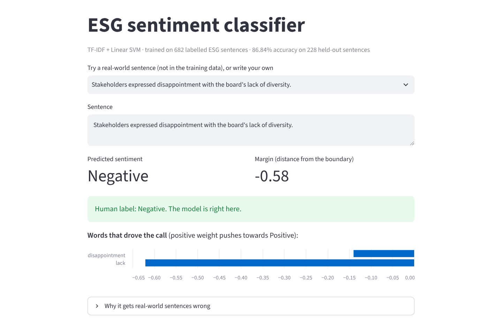

# ESG Sentiment Classifier (TF-IDF + Linear SVM)

**Gets 2 of 5 real-world ESG sentences right, after 86.84% accuracy on the test set: a TF-IDF + Linear SVM sentiment classifier, and an honest look at why it breaks on real text.**



## The problem

Analysts screening companies on environmental, social and governance practice read a lot of text. Can a fast, explainable classifier flag whether a statement is good or bad news before a human reads it?

## Approach

1. **Data:** 910 short labelled ESG sentences (471 positive, 439 negative).
2. **Split:** 75/25, stratified: 682 training and 228 test sentences.
3. **Features:** TF-IDF, English stop words removed, top 5,000 terms.
4. **Model:** Linear SVM, evaluated on the held-out set.
5. **Diagnosis:** read the model's word weights, then tested it on five real-world sentences it had never seen.

## Results

| Metric | Value |
|---|---|
| Test accuracy | **86.84%** |
| F1 (negative / positive) | 0.866 / 0.871 |
| Misclassified | 30 of 228 (13 false positives, 17 false negatives) |
| Real-world sentences correct | **2 of 5** |

| Confusion matrix (228 test sentences) | Predicted negative | Predicted positive |
|---|---|---|
| Actual negative (110) | 97 | 13 |
| Actual positive (118) | 17 | 101 |

**The real finding is the gap between 87% and 2 of 5.** The training sentences follow a few templates, so the model partly learned template words ("corp", "usage") rather than sentiment, and a bag-of-words model can't see context: "remains a significant **concern**" was called positive. The next step is training on real sustainability reports and news.

## Run it

```bash
pip install -r requirements.txt

# Interactive demo: type a sentence, see the label and the words that drove it
streamlit run app/streamlit_app.py

# The full analysis
jupyter notebook notebook/ESG_Sentiment_SVM.ipynb
```

The demo retrains the model at start-up with the notebook's exact settings, so it reproduces the 86.84%.

## What's inside

```
├── app/                         Streamlit demo
├── notebook/                    executed notebook: training, evaluation, word weights, real-world test
├── data/ESG_Sentiment.csv       the 910 labelled sentences
├── charts/                      confusion matrix, top positive and negative words
├── ESG_Sentiment_Classifier_Writeup.pdf
└── portfolio/                   data behind the website charts, with sources (facts.md)
```

## Limitations

- 16 test sentences also appear in the training set, slightly flattering accuracy.
- The model classifies sentiment only; it does not predict the ESG scores in the CSV.

## Credits

Group project (B.Tech CSBS, Semester 7, 2025) comparing several models. I built and evaluated this SVM; the labelled dataset was prepared by a teammate.

---
**Shubham Tanna** · Python, scikit-learn, pandas, Streamlit
<!-- SITE_LINK:work/esg-sentiment -->
